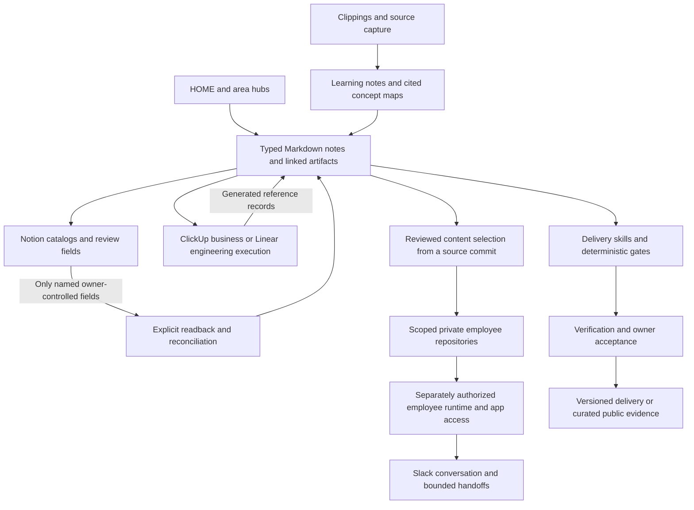

# AI Operating System — Vault Architecture Showcase

**Version 2.0** · 2026-11-13

Mark Yafi's AI OS is a private Markdown vault with a typed knowledge graph,
agent procedures, deterministic Python utilities and connected work surfaces.
This repository explains the architecture actually recorded in its current
conventions and engineering source. It publishes newly written explanations and
invented examples; the actual vault repositories remain private. [Evidence and status](docs/evidence-and-status.md).

The key separation is between durable knowledge, execution state, review fields,
employee access and delivered evidence. Each has an owner and a different release
boundary. A diagram describes their relationships; it does not certify their live health.

## Start here

| Document | What it explains |
|---|---|
| [Vault architecture](docs/architecture.md) | Actual business folder roles, note metadata, hubs, MOCs and source ownership |
| [Skills and automation](docs/skills-system.md) | Agent entry contract, deterministic utilities, review and permission boundaries |
| [Learning lifecycle](docs/learning-system.md) | Inbox, capture, source material, course/article notes, concept maps and practice |
| [Delivery workflow](docs/consulting.md) | Project specification, execution lane, phase gates, evidence and acceptance |
| [Evidence and status](docs/evidence-and-status.md) | Implemented source, public demonstrations, operating rules and proposed work |
| [Report crosswalk](docs/current-evidence-architecture.md) | November draft sections and immutable technical evidence |
| [Publication review](docs/publication-review.md) | What was inspected, excluded and verified for this documentation revision |

## What is working, and what is still to prove?

The private vault structure, metadata conventions and engineering modules were
inspected for this revision. The public runnable evidence is narrower:

| Evidence snapshot | Reproducible scope | Tests in that slice |
|---|---|---:|
| [Scoped workspaces](https://github.com/markyafi1991/scoped-ai-workspaces/tree/99105caa3be9f9f2c243ef7d6d1ca3c23d91ac02) | Committed-content selection and checked Git transaction using invented records | 17 |
| [Slack employee collaboration](https://github.com/markyafi1991/governed-slack-collaboration/tree/893cda33cdbddbc389e03ff18490abd10d5abc57) | Offline event routing, one peer handoff and replay/failure handling | 13 |
| [Engagement state](https://github.com/markyafi1991/launch-engagement-automation/tree/f6de2227fa4ffbb50dbb07ea7d35180aa35e6cf1/evidence/2026-11-13) | Per-engagement state, explicit revision checks and advisory-index recovery | 9 |

Those **39 synthetic tests** passed locally and from the source archives for the
linked evidence releases. This is not a fresh hosted CI pass or a test of the whole
vault. Live employee commissioning, real peer round-trip acceptance, complete
project-package reproduction and Launch-Engagement v1 acceptance require their
own evidence. The engine remains **Beta**. See [status definitions](docs/evidence-and-status.md).

## Explore a safe miniature

[Synthetic vault HOME](examples/synthetic-vault/HOME.md) links a context note,
fictional learning note, concept map and project specification. It illustrates
the navigation and metadata relationships without exposing actual notes, studies,
clients, task records or operating history. The examples are illustrative documents,
not an installed Obsidian configuration or a functioning sync service.

The [public showcase inventory](docs/public-showcase-inventory.md) records the
prepublication duplication review. [Report evidence pins](report-evidence-pins.json)
retain the earlier exact technical snapshots; this documentation revision does not
rewrite those commits or their release tags.

## Privacy and publication

No private repository is converted to public. New prose and invented examples are
selected explicitly; private records, credentials, internal grants and restricted
source material are excluded. Gitignore affects Git selection, not what a local
process can read. Scoped repository credentials and separately controlled app
permissions supply distinct access boundaries. See [the boundary model](docs/skills-system.md).

Published predecessor: [July Beta report](https://www.linkedin.com/feed/update/urn:li:activity:7490949064436674560).
The November continuation is unpublished; its future public URL and PDF hash must
be added after approval. A report edition does not establish a v1 software release.

Authored by Mark Yafi, Algonquin Consult LLC, with AI-assisted engineering.
Shared for portfolio review and reference under [LICENSE](LICENSE).
