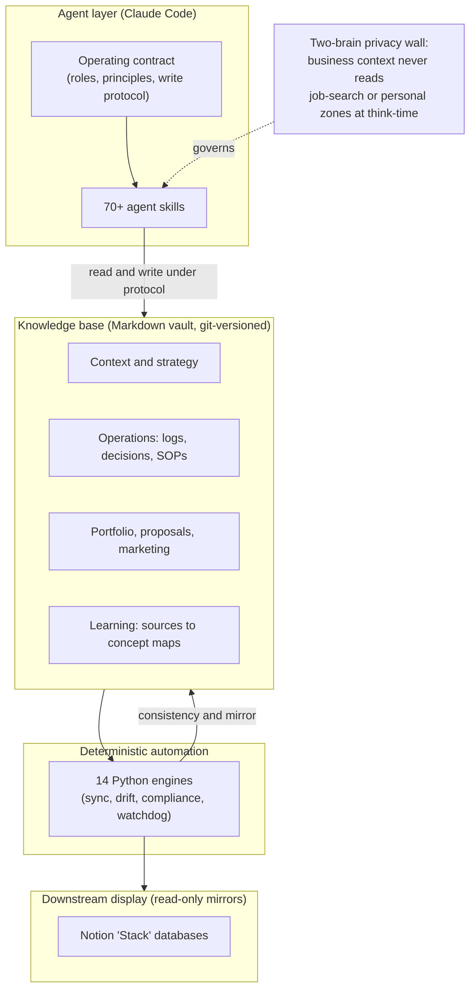

# Personal AI Operating System

A working "operating system" for running a business and a career, built on a plain-Markdown knowledge base orchestrated by AI agents. It turns a notes vault into an executable environment: 70+ purpose-built agent skills, a dozen deterministic automation engines, a hard privacy architecture, and an enforced write-protocol that keeps everything auditable.

This repository is a **sanitized, curated showcase** of that system. It documents the design and engineering — architecture, agent-skill framework, automation governance, and learning pipeline — without exposing any private business, client, financial, or personal data. (See [Privacy and sanitization](#privacy-and-sanitization) for how that line is drawn.)

> Built and operated by Mark (Mautez B. Yafi) — analytics and AI-systems consultant, Algonquin Consult LLC.

---

## What it is

Most people use an AI assistant as a chat box. This system treats AI as the **operating layer of a real business**:

- The **knowledge base** (a Markdown vault) is the source of truth — versioned in git, navigable as a graph, durable in plain text.
- **Agents** read and write that knowledge base through a fixed contract, governed by explicit operating principles rather than ad-hoc prompting.
- **Skills** are reusable, versioned agent workflows — each one a documented procedure an agent can execute on demand or proactively.
- **Automation engines** are deterministic Python scripts that keep the knowledge base consistent and mirror it into downstream display surfaces.
- A **two-brain privacy wall** structurally separates business work from private and job-search context, enforced by file boundaries rather than by instructions.

The result is a system where work is sequenced by priority, every change is logged, every external claim is traceable to a source, and nothing automated runs without a registered, manually-proven manual version first.

## Architecture at a glance

## What it demonstrates

**AI / agent engineering.** A library of 70+ agent skills, each a self-contained, versioned workflow with explicit triggers, steps, capability requirements, and a feedback loop. Multi-agent patterns (council-style review with an independent judge), MCP connector orchestration, and a model for making behaviors *proactive* via a judgment-driven contract rather than brittle hooks. See [docs/skills-system.md](docs/skills-system.md).

**Systems architecture.** A vault-as-OS design with tiered memory (hot / warm / cold), a structurally-enforced two-brain privacy wall ("keys, not prompts"), an automation-governance register, and a write protocol that keeps the whole system auditable. See [docs/architecture.md](docs/architecture.md).

**Consulting capability.** Standardized deliverables, decision-record discipline, synthetic-data portfolio practice (never real client data), and operating procedures designed to be handed off. See [docs/consulting.md](docs/consulting.md).

**Learning system.** A capture-to-concept pipeline that ingests books, papers, videos, and docs into cited source artifacts and distills them into living concept maps — with a hard "provenance or it doesn't ship" gate on anything generated. See [docs/learning-system.md](docs/learning-system.md).

## By the numbers

| | |
|---|---|
| Agent skills | 70+ documented, versioned workflows |
| Automation engines | 14 deterministic Python scripts (sync, drift detection, compliance, watchdogs) |
| Knowledge-base areas | 12 top-level domains, each with a hub index |
| Privacy zones | 3 brains (business / job-search / personal) behind a structural wall |
| Source of truth | Plain Markdown, git-versioned |

## Tech and methods

- **Markdown knowledge base** (Obsidian-compatible) as the durable source of truth
- **Claude Code** as the agent runtime; skills authored as Markdown procedures
- **Python** automation engines (consistency checks, downstream mirrors, drift detection, watchdogs)
- **MCP connectors** for integrations (e.g. a Notion display mirror)
- **git** for versioning, audit trail, and the privacy boundary
- Scheduled, governed automation under a manual-first cadence register

## What's in this repo

| Path | Contents |
|---|---|
| [`docs/architecture.md`](docs/architecture.md) | The vault-as-OS design, memory tiers, privacy wall, write protocol |
| [`docs/skills-system.md`](docs/skills-system.md) | The agent-skill framework, multi-agent patterns, automation governance |
| [`docs/learning-system.md`](docs/learning-system.md) | The capture-to-concept learning pipeline and provenance gate |
| [`docs/consulting.md`](docs/consulting.md) | Deliverable standards, decision discipline, synthetic-portfolio practice |
| [`examples/example-skill/SKILL.md`](examples/example-skill/SKILL.md) | A representative (sanitized) agent-skill definition |
| [`examples/sample-sop.md`](examples/sample-sop.md) | A representative operating procedure |
| [`examples/sample-decision-note.md`](examples/sample-decision-note.md) | A representative decision record |

## Privacy and sanitization

This showcase was built **allowlist-first**: it started empty, and only explicitly-cleared, architecture-level material was added. It is a separate repository with its own git history — it shares no commits with the private operating vault, so no confidential content exists anywhere in this repo's history.

Deliberately excluded: real client data, financial records, job-search material, and all personal content. Where the system's privacy engineering is described, it is described as design — no private content is reproduced. Any portfolio example is synthetic by design.

## About the author

Mark (Mautez B. Yafi) designs and operates AI-driven systems for analytics consulting and operations. This repository is a portfolio artifact intended to show how he architects, governs, and ships AI workflows end to end.

## License

This repository is published as a portfolio showcase. The content is shared for review and reference. It is not licensed for reuse or redistribution. See [LICENSE](LICENSE).
