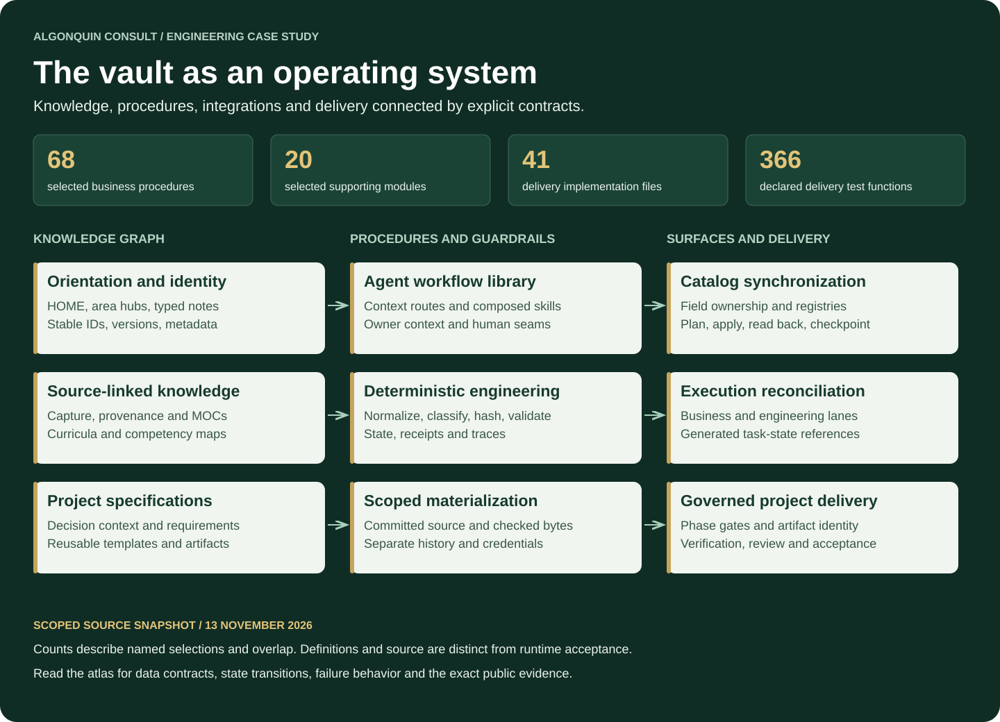

# AI OS — Engineering a governed knowledge and delivery system

**Version 3.0** · 2026-11-13

A private Markdown knowledge graph connected to a procedural agent layer,
deterministic Python tools, scoped employee repositories, application-state
reconciliation and artifact-bound project delivery. Built by **Mark Yafi,
Algonquin Consult LLC**.

The system's complexity lives in its contracts: how knowledge is typed and reused,
which surface owns a field, which source revision an employee receives, what an
approval binds, and how work recovers after an uncertain result. This repository
makes those mechanisms inspectable through a detailed architecture atlas, measured
component catalog, worked journeys and pinned runnable evidence.

## Explore the system

| Layer | What was built | Read the mechanism |
|---|---|---|
| Knowledge graph | Typed notes, stable identities, area hubs, source-linked MOCs, project specifications and artifacts | [Knowledge model](docs/atlas/knowledge-model.md) |
| Information lifecycle | Resource-specific capture, curation, provenance, learning progress, enrollment and application | [Lifecycle](docs/atlas/information-lifecycle.md) |
| Agent workflow | Context routing, composable skills, owner context and deterministic tool seams | [Agent and procedure layer](docs/atlas/agent-runtime.md) |
| Integration | Catalog planners, hash/registry change classification, field ownership and generated execution references | [Synchronization](docs/atlas/synchronization.md) |
| Permission boundary | Source-commit selection, checked bytes, managed destination history and distinct credential/app grants | [Permission and publication](docs/atlas/permissions-and-publication.md) |
| Project delivery | Structured intake, lane-specific phase contracts, per-project state and bound evidence | [Delivery engine](docs/atlas/delivery-engine.md) |
| Reliability | Explicit refusal, stale-input detection, replay handling, metadata trace and recovery paths | [Verification and recovery](docs/atlas/reliability.md) |

Start with the [architecture atlas](docs/atlas/README.md), then follow the
[three worked journeys](docs/atlas/worked-journeys.md) to see the layers interact.
The [design tradeoffs](docs/atlas/design-tradeoffs.md) explain the costs and
benefits visible in the implementation.

## Measured implementation breadth

| Inspected scope | Measurement | What the number means |
|---|---:|---|
| Selected business procedure definitions | **68**, in six families | Existing procedure definitions, not accepted employee executions |
| Selected supporting engineering modules | **20**, in five families | Named catalog, reconciliation, integrity, publication and collaboration components |
| Private delivery implementation subtree | **41 Python files** | Decomposed intake, contracts, phase runners, state, runtime and evidence machinery |
| Its test/support subtree | **17 Python files; 366 declared test functions** | Source definitions, not a fresh test execution result |

These are scoped measurements, not totals for the entire vault. The selections
overlap. [Full component catalog](docs/atlas/component-catalog.md) ·
[Machine-readable measurement and method](docs/atlas/component-inventory.json).

## Follow an actual engineering seam

| Public snapshot | Runnable evidence | Recorded synthetic tests |
|---|---|---:|
| [Scoped workspace construction](https://github.com/markyafi1991/scoped-ai-workspaces/tree/99105caa3be9f9f2c243ef7d6d1ca3c23d91ac02) | Committed content, known secret rejection, normalized held paths, checked tree, fresh/later history and update failures | 17 |
| [Employee collaboration](https://github.com/markyafi1991/governed-slack-collaboration/tree/893cda33cdbddbc389e03ff18490abd10d5abc57) | Allowed event routing, visible peer handoff, replay suppression and interrupted delivery | 13 |
| [Per-engagement state](https://github.com/markyafi1991/launch-engagement-automation/tree/f6de2227fa4ffbb50dbb07ea7d35180aa35e6cf1/evidence/2026-11-13) | Project-specific state, explicit revision checks, atomic primary write and advisory-index recovery | 9 |

Those **39 tests** passed locally and from the published source archives at the
evidence release. They exercise the declared synthetic slices. The atlas describes
additional inspected private implementation; it does not imply that all private
code or live services ship in these small public repositories.

## Current capability and acceptance

The [evidence register](docs/evidence-and-status.md) distinguishes inspected
implementation, documented operating rules, public demonstrations and pending
acceptance. Live employee commissioning, accepted automatic peer communication,
full fresh-operator package reproduction and the first accepted v1 engagement
retain their own gates. **Launch-Engagement remains Beta.**

The showcase contains newly authored explanations and invented examples. Actual
vault repositories, credentials, client information, restricted material and
private operational records remain outside the public tree.
[Publication review](docs/publication-review.md) ·
[Safe note-graph miniature](examples/synthetic-vault/HOME.md).

## Reference and report navigation

- [Vault structure and ownership reference](docs/architecture.md)
- [Skills reference](docs/skills-system.md), [learning reference](docs/learning-system.md), [delivery reference](docs/consulting.md)
- [Report crosswalk](docs/current-evidence-architecture.md) and [immutable evidence pins](report-evidence-pins.json)
- [Dated public-showcase duplication inventory](docs/public-showcase-inventory.md)

Published predecessor: [July Beta report](https://www.linkedin.com/feed/update/urn:li:activity:7490949064436674560).
The November continuation remains unpublished. Its document edition is separate
from the engine's release milestone. Preserve the referenced code tags as the
system and report evolve.

Shared for portfolio review and reference under [LICENSE](LICENSE).
