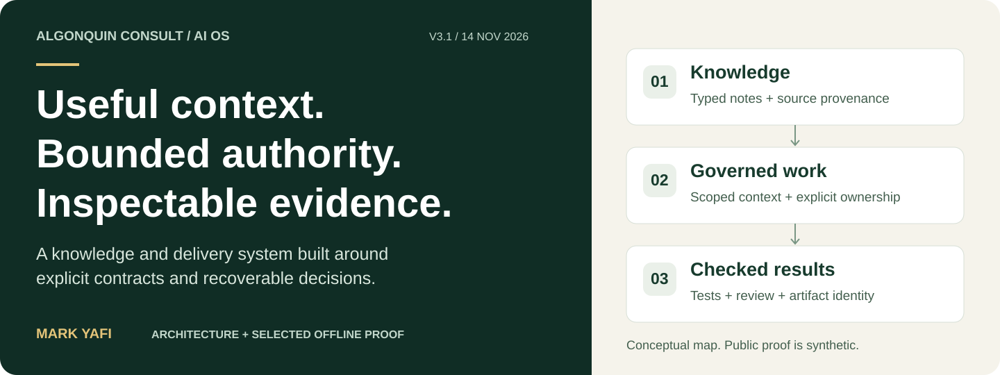
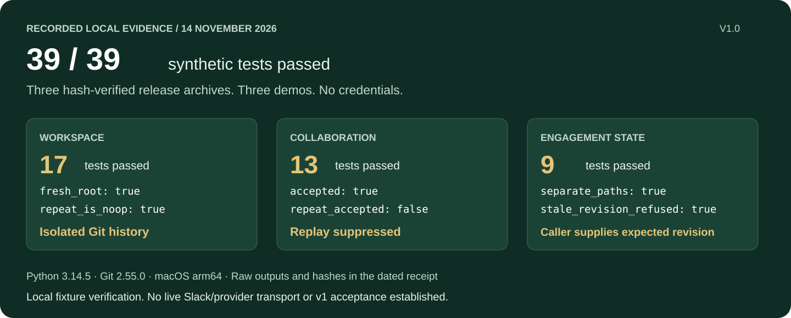
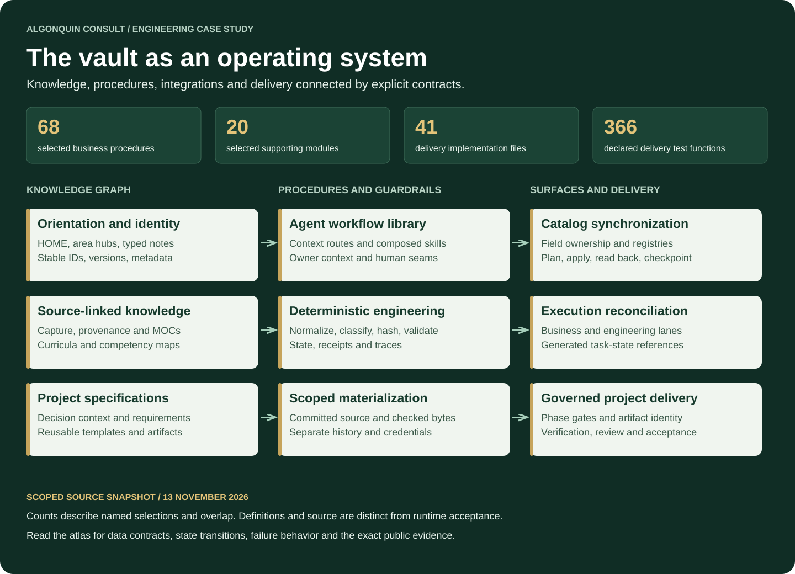

# AI OS — From knowledge to governed execution

**Version 3.1** · 2026-11-14

**How do you give AI agents useful context without giving them uncontrolled authority?**

AI OS is Mark Yafi's knowledge and delivery system: typed Markdown knowledge,
composable agent procedures, scoped repositories, explicit ownership across tools,
and project gates tied to evidence. This showcase opens the architecture and
selected code to inspection through synthetic examples.

**Start here:** [Engineering review](docs/engineering-review.md) ·
[Run the public proof](docs/reproduce.md) ·
[Explore the full architecture](docs/atlas/README.md)

## Three behaviors you can verify

The engineering challenge is concrete: copying context can carry unwanted history,
retrying a message can repeat effects, and saving stale state can overwrite newer
work. The public slices expose how those failures are handled.

| Challenge | Observed synthetic result | Inspect the evidence |
|---|---|---|
| Give an employee only selected committed context | One selected file; a fresh Git root; unchanged input produces no new commit | [Workspace code and 17 tests](https://github.com/markyafi1991/scoped-ai-workspaces/tree/99105caa3be9f9f2c243ef7d6d1ca3c23d91ac02) |
| Admit a bounded two-role conversation once | First event accepted; its replay refused; two visible same-thread fixture messages | [Offline collaboration code and 13 tests](https://github.com/markyafi1991/governed-slack-collaboration/tree/893cda33cdbddbc389e03ff18490abd10d5abc57) |
| Protect separate engagements from stale writes | Distinct project paths; a stale revision is refused when the caller supplies the expected revision | [State code and 9 tests](https://github.com/markyafi1991/launch-engagement-automation/tree/f6de2227fa4ffbb50dbb07ea7d35180aa35e6cf1/evidence/2026-11-13) |

**39/39 tests passed again on 2026-11-14**, from the three hash-verified published
archives. [Commands, environment and raw results](evidence/2026-11-14/README.md) ·
[Machine-readable receipt](evidence/2026-11-14/verification.json).
These are local fixture results. Live Slack/provider calls, full-vault behavior
and product-v1 acceptance have separate gates.

## Engineering judgment, made inspectable

- **Content scope and history are separate boundaries.** The workspace transaction
  checks the resulting tree and moves managed references together. A prompt is
  never treated as a repository permission. [Transaction and failure cases](docs/atlas/permissions-and-publication.md).
- **A retry is a design decision.** Recording admission before external effects
  suppresses repeat execution, while interrupted delivery needs reconciliation.
  [Replay and partial-delivery case study](docs/engineering-review.md).
- **Mapped fields have explicit owners.** Specifications, execution state and owner
  review marks have distinct authorities; adapter contracts preserve those assignments.
  [Field ownership and reconciliation](docs/atlas/synchronization.md).
- **Approval follows the artifact.** Changed prerequisites or deliverables require
  fresh evidence under the delivery contracts. [Phase gates and invalidation](docs/atlas/delivery-engine.md).

The [design tradeoffs](docs/atlas/design-tradeoffs.md) discuss the costs as well
as the benefits. The [review guide](docs/engineering-review.md) connects these
choices to exact public code and tests.

## The system behind the proof

The three public slices are entry points into a broader architecture. The atlas
has nine chapters, eight diagrams, a component catalog and worked journeys.

| Layer | Inspect the mechanism | Evidence category |
|---|---|---|
| Knowledge | [Typed notes, stable identity, provenance and MOCs](docs/atlas/knowledge-model.md) · [resource lifecycle](docs/atlas/information-lifecycle.md) | Inspected design and synthetic note graph |
| Agent procedures | [Context routing, skill composition and tool responsibilities](docs/atlas/agent-runtime.md) | Inspected definitions; offline handoff slice |
| Integration | [Field ownership, registry hashes and generated references](docs/atlas/synchronization.md) · [connected catalogs](docs/atlas/connected-catalogs.md) | Inspected implementation and operating rules |
| Employee access | [Selected bytes, checked history and separate application grants](docs/atlas/permissions-and-publication.md) | Public local transaction slice; live access requires verification |
| Delivery | [Lane-specific phase contracts and artifact dependencies](docs/atlas/delivery-engine.md) | Inspected private engine; public state primitive |
| Reliability | [Refusal, partial failure, trace and recovery](docs/atlas/reliability.md) | Declared synthetic tests and explicit acceptance limits |

The selected inventory measures **68 business procedure definitions** and **20
supporting modules**. Separately, the private delivery subtree contains **41 Python
implementation files** and **17 test/support files with 366 declared test functions**.
These overlapping source measurements establish breadth; they are not additional
passing tests. [Catalog and measurement method](docs/atlas/component-catalog.md).

## Ownership and working method

**Mark Yafi · Algonquin Consult LLC** — system owner and architect. This is an
owner-directed system built and refined with AI coding assistants. AI assistance
includes implementation, tests and this public documentation; the public history
is curated rather than a complete history of the private build.

The reviewable work is the architecture, interfaces, permission boundaries,
verification methods and delivery workflow. Selected implementation extracts and
their provenance live in the linked evidence repositories. This hub explains how
they fit together. [Public profile](https://github.com/markyafi1991) ·
[Publication method and review history](docs/publication-review.md).

## Status and further reading

**Demonstrated:** the three declared synthetic code slices above. **Inspected:**
the selected broader private implementation and contracts described in the atlas.
**Acceptance pending:** program-wide live employee commissioning, complete
fresh-operator package reproduction and an accepted v1 engagement.
**Launch-Engagement remains Beta.** [Full evidence register](docs/evidence-and-status.md).

- [Synthetic note graph](examples/synthetic-vault/HOME.md) · [three cross-layer journeys](docs/atlas/worked-journeys.md)
- [Vault reference](docs/architecture.md) · [skills](docs/skills-system.md) · [learning](docs/learning-system.md) · [delivery](docs/consulting.md)
- [Report crosswalk](docs/current-evidence-architecture.md) · [immutable code/archive pins](report-evidence-pins.json)
- [Dated showcase inventory](docs/public-showcase-inventory.md) · [publication review](docs/publication-review.md)

Published predecessor: [July Beta report](https://www.linkedin.com/feed/update/urn:li:activity:7490949064436674560).
The November continuation remains unpublished; its edition does not establish v1
shipment. Actual vault repositories and operational records stay private. All
examples in this showcase are invented. Shared for evaluation under [LICENSE](LICENSE).

## Sources

The behavioral claims above trace to the [exact code/archive pins](report-evidence-pins.json)
and [dated local execution receipt](evidence/2026-11-14/verification.json). Broader
architecture claims retain the [scoped component inventory](docs/atlas/component-inventory.json)
and [publication review](docs/publication-review.md), with private inspection kept
distinct from public reproduction.
