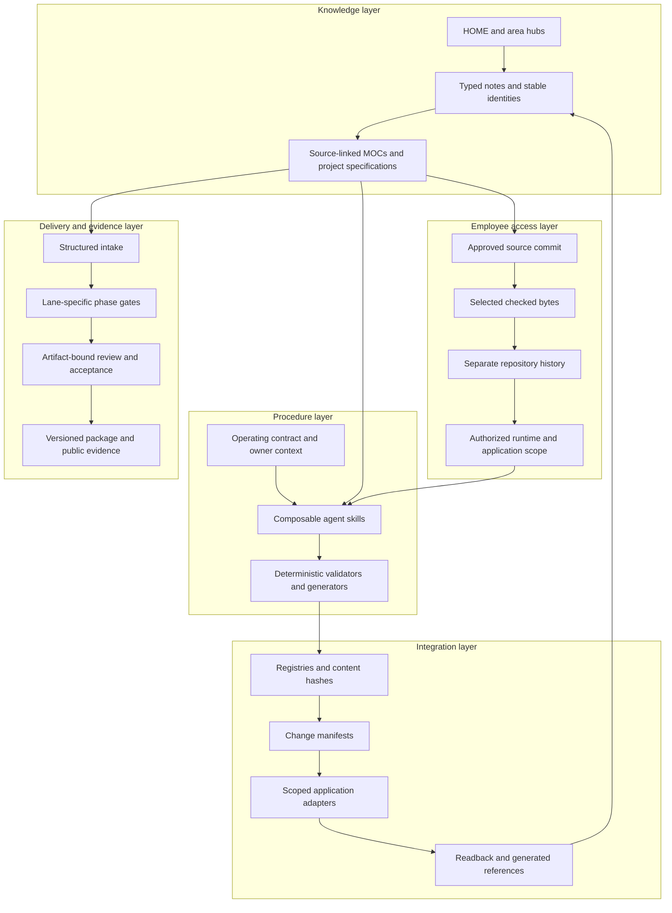

# Architecture atlas — how the vault works as a system

**Version 3.0** · 2026-11-13

This atlas follows the implementation seams that make the vault more than a
folder tree: entity identity, provenance, ownership, state transitions, scoped
materialization, decision gates and recovery. It complements the shorter reference
pages with mechanisms, data contracts and failure cases.

## Engineering reading path

| Chapter | Central question | Concrete design material |
|---|---|---|
| [01 — Knowledge model](knowledge-model.md) | How does a file become a typed, navigable system object? | Entity relationship diagram, schema families, ownership and graph invariants |
| [02 — Information lifecycle](information-lifecycle.md) | How does an input become reusable knowledge and then applied work? | Separate lifecycle state machines, provenance chain and maturity distinctions |
| [03 — Agent and procedure layer](agent-runtime.md) | How does an agent find context and execute a governed procedure? | Context routing, workflow composition, capability contract and procedure families |
| [04 — Synchronization](synchronization.md) | How do multiple tools exchange state without becoming competing masters? | Field ownership, registry/hash diff, adapters, checkpoints and reconciliation |
| [05 — Permission and publication](permissions-and-publication.md) | Which bytes and authorities does an employee actually receive? | Trust-boundary diagram, checked Git transaction and failure matrix |
| [06 — Delivery engine](delivery-engine.md) | How does the project move through phases without losing evidence identity? | Lane routing, phase matrix, artifact dependency graph and invalidation |
| [07 — Reliability and verification](reliability.md) | What does a passing check prove, and how can the process fail safely? | Failure catalog, evidence taxonomy, trace semantics and review boundaries |
| [08 — Three worked journeys](worked-journeys.md) | What happens when these subsystems interact? | Knowledge-to-project, catalog round trip and scoped employee handoff |
| [09 — Connected catalogs](connected-catalogs.md) | How are procedures, tools, sources, repositories and projects kept legible? | Catalog graph, dependency relations, owner review and lifecycle distinctions |
| [Component catalog](component-catalog.md) | What supporting implementation exists beyond the three public demos? | Selected procedure families, actual module names/functions and measured source scope |
| [Design tradeoffs](design-tradeoffs.md) | Why do these seams exist, and what do they cost? | File model, single-writer fields, private snapshots, manual gates and recoverability |

## The five interacting layers

These are explanatory groupings of the built system, not five separately deployed products.

The connection points matter. A task readback cannot rewrite a requirement just
because its status changed. A catalog adapter cannot own an owner's review mark.
A new role definition cannot grant repository access. A regenerated deliverable
cannot silently inherit an approval bound to its previous bytes.

## Measurement and evidence

The selected catalog contains **68 business procedure definitions** in six
families and **20 named supporting engineering modules** in five families. The
private Launch-Engagement subtree independently contains **41 Python implementation
files** and **17 Python test/support files with 366 declared test functions**.
These scopes overlap and must not be added together as a total system size.
The measurements inspect definitions and source layout, not deployment activity.
See [measurement details](component-catalog.md) and [machine-readable inventory](component-inventory.json).

Each chapter ends with an evidence boundary. **Inspected private implementation**,
**documented operating rule**, **public synthetic demonstration** and **acceptance
target** have distinct meanings. The [evidence register](../evidence-and-status.md)
retains the exact runnable public proof. No source code or real record is implied
to be publicly available merely because its architecture is described here.
