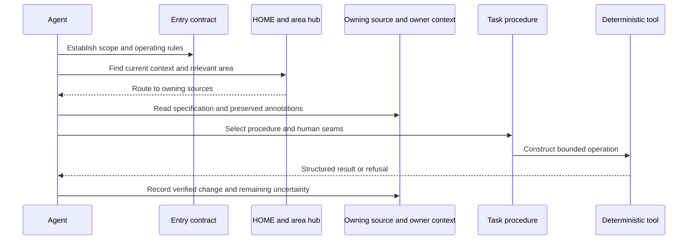

# 03 — Context routing, skills and deterministic tools

**Version 3.0** · 2026-11-13

The agent layer is organized around a durable operating contract and composable
procedures. It does not rely on a single giant conversation containing the whole
vault. The engineering problem is to provide the right context, preserve ownership,
choose an authorized action and verify the result.

## The context route

The route is a documented workflow, not evidence that every agent follows it
perfectly. Filesystem/sandbox scope, repository credentials and app permissions
still determine what actions are physically possible.

## What the procedure definition contributes

| Procedure element | Why it matters to execution |
|---|---|
| Trigger and task scope | Establish whether this workflow applies |
| Required source context | Avoid reasoning from stale chat or unrelated material |
| Ordered steps | Make dependencies and human seams explicit |
| Input/output paths or contracts | Give deterministic tools a bounded interface |
| Capability requirements | Expose missing access instead of pretending an operation happened |
| Verification and refusal conditions | Separate a completed action from an assistant's assertion |
| Feedback and handoff | Preserve a resumable state and repair recurring process defects |

Companion owner notes and annotations add context without becoming writable agent
review marks. A stored skill procedure can describe code and human work together;
it is not itself a sandbox, scheduler or proof of runtime acceptance.

## Procedure families in the selected catalog

The [component catalog](component-catalog.md) enumerates 68 selected business
definitions spanning capture, learning design, strategy, delivery/artifact
production, catalogs/integrations and verification/maintenance. The breadth matters
because these procedures share contracts and sources: a capture feeds a MOC; a
strategy procedure feeds a project specification; delivery composes child skills;
verification and provenance apply across those outputs.

The catalog is deliberately scoped and does not enumerate restricted workflows.
It measures existing definitions, not employee proficiency or successful executions.

## Division of responsibility with code

Language-model work includes interpreting a request, drafting an explanation,
choosing among relevant procedures and identifying gaps. Deterministic modules
perform operations that need exact repeatability: normalize inputs, compare enums,
construct command plans, hash defined field sets, validate source paths, classify
changes and persist state. Calling code does not remove judgment; it narrows which
parts of a result are machine checked.

For example, a discovery gate can check that a source is allowlisted and that an
artifact is hash-bound. That does not prove the business truth of every sentence.
A sync planner can mark a row DRIFTED without having contacted Notion. An event
router can refuse an unknown Slack author without proving a deployed provider is
available. The [reliability chapter](reliability.md) follows these distinctions.

## Employee identity and handoff

Role instructions, model/provider, process identity, Slack author and repository
credential are separately meaningful. The published coordinator accepts a roster
of employees and bounds a turn to one optional peer handoff. The lead's visible
message and handoff question become peer context; the peer's answer is final for
that bounded turn. Source material is context, not authority to grant new tools.

A live employee adds commissioning obligations: correct identity, approved scope,
supported trigger, access to the right context/queue, observable delivery and a
recovery path. Those obligations stay visible without reducing the chapter to a
claim that a saved role or installed SDK is a working employee organization.

**Evidence boundary:** current procedure definitions and first-party routing/code
structure were inspected. Public offline behavior is demonstrated by the pinned
collaboration slice ([A3](../evidence-and-status.md#a3)); no private instructions,
agent credentials or actual conversations are reproduced.
