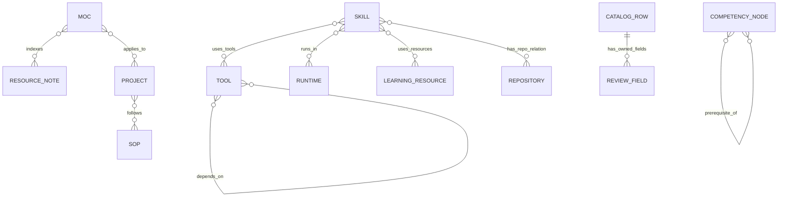

# 09 — Catalogs as a connected operating graph

**Version 3.0** · 2026-11-13

The display layer is more than a set of copied pages. The vault maintains
different catalogs for things with different lifecycles: procedures, tools,
connectors, SOPs, folder/index architecture, concept maps, competencies, learning
sources and repositories. Their relationships make the operating system navigable
across application and knowledge boundaries.

## The catalog graph

The diagram is a conceptual view of relations described by the catalogs and
procedures, not a declaration that every shown edge is a live Notion relation.
For example, the inspected Skill Stack source explicitly includes `runs_in`,
`uses_tools`, `uses_resources` and `repo` links plus pending-link metadata. MOC
source prepares concept/resource relations. Competency source extracts node data.
These are distinct adapter contracts, not interchangeable generic row copies.

## Why the catalogs are separate

| Catalog/object | What its identity means | What a review is deciding |
|---|---|---|
| Tool | A product/runtime/component with a defined job | Fit, dependency, use and owner-directed changes |
| Connector | An integration capability and its documented role | Scope and necessity; connection is separate from permission acceptance |
| Skill | A procedural capability definition | Intended use, provenance, linked tools and required context |
| SOP | A repeatable operating procedure | Whether the ordered steps and verification remain appropriate |
| Vault Map | A folder/index architecture entry | Where knowledge belongs and how an agent finds it |
| MOC | A reusable concept index | Whether concepts retain supporting sources and applications |
| Skill tree node | A competency with prerequisites | What evidence is required and what is actually demonstrated |
| Learning source/platform | A source of resources | How captured material is associated with that source |
| Repository | An implementation or reference location | What role it serves and which exact revision supplies evidence |

One learning platform can supply many captured resources. A runtime can support
several procedures. A dependency can make an apparently unused tool significant.
A source description can change while its catalog identity remains stable. These
are the reasons a single list of app names would lose useful structure.

## Judgment metadata belongs alongside generated fields

The inspected skill enrichment combines definition-derived fields with registry
provenance, review/audit metadata and relations. It hashes the declared mirrored
payload to detect a meaningful change. Other catalogs define different payloads.
This lets generated content and curated judgment coexist, provided their owners
and update rules stay explicit.

Owner-reserved annotations and review marks must be preserved. An agent can
record what it checked in the appropriate change/comment layer; it cannot silently
promote itself to an owner-approved state. A catalog that displays a review field
also does not authenticate the person who reviewed a separate deliverable.

## Presence, wiring, activation and acceptance

The architecture repeatedly needs four distinct questions:

1. Does a definition, module or product exist?
2. Has it been configured for the intended job and linked to its dependencies?
3. Is it authorized and activated in the actual target execution context?
4. Has its declared behavior passed the relevant acceptance test?

A tool note can describe a target state while the machine still has an off-plan
installation. A connector can be available to a client without a granted employee
connection. A skill can have an excellent procedure without having completed a
live run. A registry can contain an external ID while the destination has drifted.
The catalogs make these questions visible; they do not answer them automatically.

## Governance as maintenance work

Definitions, field maps, procedures, dependency links and source descriptions can
all drift. The system supplies separate activities for checking source/schema
consistency, surfacing dirty mirrored rows, reviewing a tool, recording changes
and reconciling execution. A cadence register can govern a recurring activity,
but the presence of its code or description is not proof that a schedule is active.

This is also why an architectural change should update affected documentation and
why publication review should consider relation and metadata leaks, not just note
bodies. Excluded record names and grant identifiers are information too.

**Evidence boundary:** source contracts for the selected catalogs and procedures
were inspected. No actual catalog registry rows, owner decisions, tool subscription
details, account identities, permission grants or live database IDs are published.
The [source catalog](component-catalog.md) and [synchronization chapter](synchronization.md)
describe implementation scope without claiming a fresh integration health audit.
