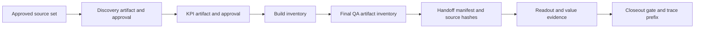

# 06 — The delivery engine and artifact dependency graph

**Version 3.0** · 2026-11-13

Launch-Engagement supplies a phase-oriented spine for turning an intake into a
project, its artifacts and acceptance evidence. Its private source separates
normalization, state, command planning, phase contracts, evidence generation and
phase execution. It is not one prompt that declares a project complete.

## Implementation scope measured

The inspected private subtree contains 41 Python implementation files and 17 Python
test/support files with 366 declared test functions. Source definitions were counted
with AST parsing; this is not a fresh execution result or a public-code file count.
The [component inventory](component-inventory.json) records the exact scope.

## Intake and lanes

Intake normalization establishes project kind, delivery lane, data classification,
project identity and starting phase. Routing and resume checks then determine
what is applicable and which prior artifacts are required. Portfolio intake is
restricted to synthetic or approved public inputs.

| Lane | Phase eligibility | Important seam |
|---|---|---|
| Tool-built BI | 0–9, with readout applicability determined by project kind/option | Kit, build, QA and handoff contract |
| Software/code | 0–2 and applicable 7–9 | Engineering execution lane; kit phases 3–6 skipped |
| Advisory | 0–2 and applicable 7–9 | Advisory work without kit phases 3–6 |

The implementation's current shared skip sets govern this table. Older public
extracts may contain earlier routing/state behavior; they must not be treated as
the complete current private engine. Phase 7 is conditional for portfolio work.

## Phase-by-phase artifact contracts

| Phase | Responsibility | Evidence or machine-bound contract |
|---|---|---|
| Intake | Validate and normalize request; plan lane and resume | Typed intake, normalized state and emitted commands |
| 0 — Setup | Scaffold or recognize project and runbooks | Required nonempty artifacts; project-specific state |
| 1 — Discovery | Establish decision context and source basis | Assessment shape, approved sources, semantic/intake hash and approval age |
| 2 — KPIs | Define decision-linked measures | KPI contract, approved discovery binding, measure IDs and semantic hash |
| 3 — Kit | Deploy applicable project kit and execution structure | Template fidelity, hydrated requirements, recipe and local provision receipt |
| 4 — Build | Record the declared artifact candidate | Artifact inventory, validation-output interpretation and explicit human checkpoint |
| 5 — QA | Bind final post-QA candidate to definition of done | Structured result evidence, expected/actual checks and carried-forward controls |
| 6 — Handoff | Assemble the delivery artifact set | Manifest membership/hashes, measure coverage, citation/render/transfer attestations |
| 7 — Readout | Produce applicable narrative and recipient artifacts | Source/KPI binding, artifact checks and recorded confirmations |
| 8 — Value | Define how intended value will be owned and measured | Value/governance structure, source bindings, direction checks and approval |
| 9 — Close | Record terminal disposition and retrospective | Distinct evidence pointers, prerequisite verification and terminal state |

The table describes private implementation responsibilities. The current public
engine extract ships a narrower runnable surface, and the newer public state slice
ships only its explicitly mapped state primitives. Neither exposes this full chain.

## Why downstream evidence goes stale

A downstream gate is meaningful only while its bound inputs remain current.
Changing a source, requirement, approved measure, evidence artifact or definition
of done can require revalidation rather than a blind resume. Some gate bindings
use semantic normalization, so formatting changes and meaning changes must be
distinguished by the applicable contract rather than one universal file-hash rule.

The lifecycle also distinguishes authoring-time rules from lasting invariants.
For example, a target date's validity when a value plan was authored is different
from the requirement that the plan's approved content remain unchanged afterward.
Recovery/reopen paths preserve work and superseded decisions rather than forcing
a user to pretend the original gate never existed.

## Per-project state and run traces

State uses a project-derived path, engagement identity, schema version, revision
and phase metadata. Atomic persistence and optional expected-revision checks reduce
accidental overwrites; callers must supply the revision comparison. The advisory
index is best-effort and not a cross-host transactional database.

The shared trace implementation records bounded metadata and hash bindings across
several entry points. Existing engagements can begin with an explicit partial-history
marker. Trace verification can distinguish an append-safe bound prefix from later
appends. A hash chain detects changes relative to its anchor; it is not proof of
which human took an action or an immutable external attestation.

## The human and application seams

Machine checks cover structure, hashes, sources, declared results and recorded
attestations. They cannot establish that a person actually opened a desktop tool,
that a client had authority, that funds settled, or that a recipient successfully
used a delivered package. Those need appropriate direct or human evidence.
The documented owner interaction is not cryptographic authentication merely
because a receipt contains a name or the process requires a terminal.

**Evidence boundary:** private source inspection and the narrower pinned public
state proof ([A4](../evidence-and-status.md#a4)). The engine remains Beta. A full
accepted engagement, live tool acceptance and fresh-operator package reproduction
remain separate v1 acceptance work.
