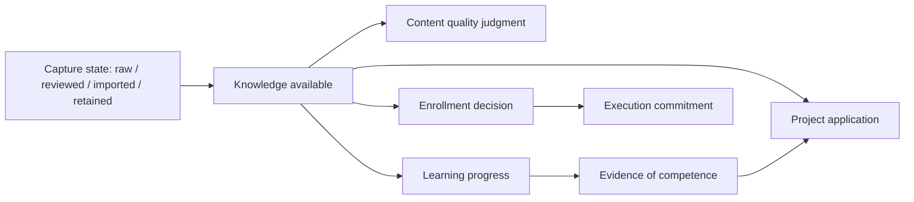

# 02 — From captured input to applied knowledge

**Version 3.0** · 2026-11-13

The vault has several interacting lifecycles. Capture, curation, learning progress,
enrollment, competence and project delivery each answer a different question. The
architecture gains precision by recording these states separately.

## The intake branches

| Input | Initial role | Possible next artifact |
|---|---|---|
| Web clipping | Raw external/unvetted inbox entry | Curated clip, article capture or retained reference |
| Business bookmark | Lightweight URL pointer | Source capture when the content is needed |
| Video or article | Resource with metadata and an extractable body/transcript | Structured learning note with summary, outline, provenance and concepts |
| Heavy book/PDF/docs tree | Multi-part source material | Source index and page/chapter artifacts plus an analyzed resource note |
| Reusable prompt | Procedure text with origin | Explicitly captured prompt artifact in its own library |

Those branches are implemented by different capture procedures. A bookmark does
not need to become a clipping first, and a heavy source is not identical to the
resource note that analyzes it. The public catalog shows the source-type breadth
without republishing captured external text.

## Independent state dimensions

The arrows describe possible relationships rather than automatic promotions.
Quality is not urgency; a saved resource is not a commitment; finishing a resource
is not evidence of mastery; linking a resource to a project does not prove it was
applied correctly. The current learning contract uses the designated program board
for committed membership and keeps resource-note content canonical in the vault.

## Provenance is carried through the chain

A useful source binding includes author/title/publisher where known, original URL,
and the relevant page, chapter or timestamp. Heavy-source pages retain a parent
relationship so the page can be traced to the whole resource. A MOC concept links
to the supporting note. A project links the relevant concept or resource rather
than silently treating raw inbox material as established fact.

When the system produces an outward claim, citation checking asks for the specific
supporting source. When the claim is about this system's behavior, the evidence is
the implementation and its observed execution. A note describing a validator is
not equivalent to running that validator. This distinction applies to the showcase
itself as well as to research outputs.

## The curation loop

The inspected clippings engine separates source/type/category identification,
quality scoring, body signatures, curation ranking, stamping and catalog building.
These are distinct functions rather than one opaque prompt. Duplicate detection
and ranking help manage the inbox; judgment is still required for ambiguous content.
The architecture does not assume the entire inbox is already curated or that every
source has perfect metadata.

The learning graph then connects Tool/Area MOCs, curricula, competency trees,
practice and applied projects. Each tool has a narrower job: a curriculum lays out
a path; a competency tree expresses prerequisite structure; a tutoring procedure
drives practice; an execution board allocates committed work. Their state must not
be collapsed into one generic "learning complete" flag.

## Failure and repair points

| Failure | Architectural response | Evidence needed before claiming repair |
|---|---|---|
| Missing original URL or citation | Hold the claim or recover known provenance | Corrected source binding, not an invented citation |
| Incomplete transcript/body | Record capture limit and recapture through the owning procedure | Actual recovered material and extraction result |
| Duplicate capture | Use signatures/identity and preserve the appropriate source chain | Deduplication check with links intact |
| Conflicting progress/enrollment | Reconcile the correct state dimension with its owning surface | Current membership/state readback |
| Stale concept or broken link | Revisit the MOC/source/application chain | Link and claim verification |
| Captured restricted text | Keep it behind the authorized boundary | Safe summary/citation, not outward redistribution |

**Evidence boundary:** the source schema, curation implementation and capture
procedure definitions were inspected; no real reading history or captured source
body is published. The artificial source in the miniature is deliberately fictional
and cannot support an external factual claim. [A1](../evidence-and-status.md#a1).
