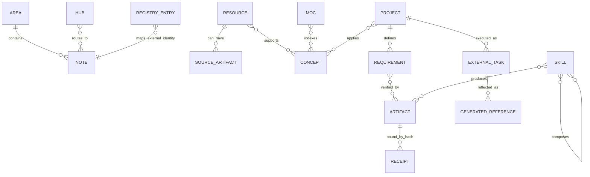

# 01 — The knowledge model and its invariants

**Version 3.0** · 2026-11-13

The primary store is a set of files with a shared identity and metadata contract.
Directories supply area context; note types supply semantics; links supply
relationships; registries hold external identities and synchronization checkpoints.
Obsidian makes the graph usable, while plain files keep the material readable to
different agent tools.

## Entity model

This is a conceptual model distilled from the existing note and engineering
contracts. It is not a claim that the vault stores every relationship as a
separate relational table. Requirements may live in structured artifacts; concept
relationships may be Markdown links; receipt bindings may be JSON hashes.

## Schema families

| Object family | Typical fields or structure | Semantic responsibility |
|---|---|---|
| Durable note | ID, type, lifecycle status, created/updated dates, tags | Identity and classification independent of a rendering tool |
| Authored document | Version plus visible version/date line | Identify what a recipient is reading when frontmatter is hidden |
| Learning resource | Resource type, author, publisher, URL, area/tool, progress, rating, position | Describe the source and learning state |
| MOC | Source-linked concepts, resource index, applications | Connect reusable ideas to work |
| Project dossier | Scope, delivery lane, requirements and linked artifacts | Own the project meaning and acceptance intent |
| Generated execution reference | Source tool, external ID, status, reconciliation time, do-not-edit notice | Represent remote execution state without creating a second author |
| Registry entry | External page/task ID, source hash, synchronization state | Maintain cross-system identity and detect changes |
| State/gate receipt | Schema version, project/engagement identity, revision, hashes, phase status | Bind a machine decision to its declared inputs |

The shared schema gives a note a basic contract, but type-specific fields carry
different meanings. A learning `progress` field does not replace the note's
lifecycle `status`. A task's execution status comes from the execution surface.
An owner's review mark is not an agent's statement about itself.

## Three navigation systems coexist

**Physical routing:** the business directories distinguish durable context,
operations, proposals, portfolio work, marketing, reusable templates, administration,
learning, creative work and archive. Restricted areas and actual records are
excluded from this publication.

**Entry routing:** HOME leads to area hubs. A hub can combine curated links with
metadata-driven views. An agent uses it to find the owning document before writing.

**Concept routing:** Tool and Area MOCs connect resources, durable concepts and
applications. This is how a project can reuse knowledge without importing an entire
source library into its working context.

The [synthetic miniature](../../examples/synthetic-vault/HOME.md) shows a resource
linked to a MOC and a project. The [worked journey](worked-journeys.md) adds the
state and authority questions that a simple note graph cannot express by itself.

## Identity and version are different

A stable note identity answers which object this is. A document version answers
which authored edition a reader received. A Git commit identifies committed tree
contents. An external page/task ID identifies an object on another surface. A
content hash identifies selected bytes or normalized fields. The system needs all
of them because none answers every question.

For example, a Notion row may keep its page ID while the vault-owned description
changes. An engagement can keep its UUID while its state revision increases. A
report can keep an edition label while citing a precise evidence commit. Treating
any one of those as universal identity would conceal change.

## Invariants and deliberate exceptions

1. Durable meaning has an owning source. A copied view is not automatically a new master.
2. Field ownership is explicit at integration seams; no field is intentionally writable from both sides.
3. Generated references are regenerated, not hand-maintained as competing records.
4. Owner annotations and approval marks are a reserved layer, preserved by agents.
5. An external claim needs provenance, while a machine acceptance claim needs actual run evidence.
6. Dated logs, reusable templates and generated references have documented metadata exceptions.

These are the documented system contracts. Checking every historical note against
them is a separate lint/audit task. The architecture should explain exceptions
instead of flattening them into a claim of universal conformance.

**Evidence boundary:** current conventions and selected implementation were
inspected privately ([A1](../evidence-and-status.md#a1)). The example notes are
invented; no actual graph contents, private history or client record is published.
