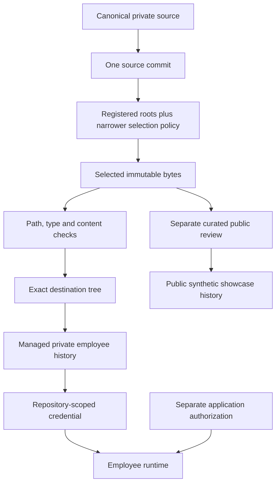

# 05 — Trust boundaries and the checked publication transaction

**Version 3.0** · 2026-11-13

The vault, backup, employee copy, project delivery and public showcase are
different products of the source system. They must not inherit each other's
content scope or access rights merely because they share a tool.

The public branch in this diagram is a separately reviewed publication path. It
is not the automatic destination of the private layer builder. Real records,
internal grants and credentials are not material for a public demonstration.

## Where enforcement happens

| Control | Implementation seam | Intended guarantee and limit |
|---|---|---|
| Registered export roots | Code-level layer root allowlist | Configuration can narrow the layer; cannot invent a broader code root |
| Restricted path refusal | Normalized path checks and exclusions | Detect known denied paths; still requires correct scope design |
| Immutable source selection | Git tree/object reads from the selected commit | Working edits and ignored/untracked files do not become that commit's blobs |
| Type and content validation | File-mode checks, permitted content and signatures | Reject known unsafe inputs; signatures are not universal semantic privacy proof |
| History separation | New destination history and managed-head record | Do not retain private source parents or silently build on an unknown destination head |
| Exact-tree comparison | Object IDs recomputed from the checked bytes | Verify the result actually contains the selected bytes and expected parents |
| Atomic reference update | Branch and managed ref in one compare-and-swap transaction | Fail when the expected head changes; injected failure tests are not a real race benchmark |
| Private destination check | Fixed effective push address and server visibility check | Keep private publication on its approved private destination |
| Public release review | Explicit content selection, synthetic fixtures, manifests and owner approval | Authorize only the reviewed outward package |

## The transaction in detail

1. Validate the layer/repository suitability and collect checked content from the
   selected source revision through the appropriate collector.
2. Read the destination branch and the builder's own managed-history reference.
   Refuse symbolic references or a mismatch that indicates an unmanaged history.
3. If the entire expected tree already matches, return a no-op rather than
   manufacturing a new content revision.
4. Build one commit on a temporary reference from the checked bytes, with the
   expected destination parent. A first publication has no source-history parent.
5. Read its tree back and compare every mode, object type and object ID, including
   missing or unexpected files. Verify parent identity.
6. Move the branch and managed-history ref together using expected old values.
   Clean the temporary ref. An intervening head change causes refusal.
7. A separate authorized transport step pushes only the intended ref and reads
   the remote result back. A timeout is an uncertain outcome until reconciled.

The published [workspace slice](../evidence-and-status.md#a2) exposes selected
transaction primitives and an invented collector. It deliberately does not expose
the complete live policy, real source inventory, grant list or private record exports.

## Credentials are another boundary

Gitignore controls Git selection, not arbitrary local filesystem reads. A remote
employee's filtered repository and scoped credential can reduce its accessible
context; that says nothing automatically about a separately connected app. An
account-wide integration can have different authority from a repository-scoped
key. Role instructions and a model name are not access controls.

An employee can therefore be defined but unprovisioned, provisioned for one
repository but not an app, or installed without accepted automatic communication.
The architecture tracks those distinctions rather than collapsing them into an
"employee active" checkbox.

## Failure behavior worth reviewing

| Scenario | Safe response |
|---|---|
| A user edits the source after the selected commit | Keep the committed bytes; the newer edit belongs to another reviewed revision |
| A source entry is a symlink or has a denied mode/path | Refuse before it enters the checked collection |
| A target branch was modified outside the managed history | Refuse the update; investigate rather than retaining unknown history |
| Generated commit contains an extra file | Fail tree comparison before moving the published branch |
| Target head changes during commit preparation | Fail the reference transaction and reconcile |
| Push result is uncertain | Inspect the exact remote ref before retrying |
| Public review finds sensitive content | Hold the publication; source deletion alone is insufficient after exposure |

**Evidence boundary:** implementation inspection plus the pinned public local-Git
fixture tests ([A2](../evidence-and-status.md#a2)). Private visibility was checked
for the earlier publication, but this is not an account-wide app-access audit or
a fresh proof of every employee's effective permissions.
