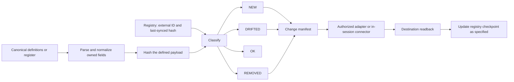

# 04 — Field ownership, registries and reconciliation

**Version 3.0** · 2026-11-13

Synchronization is several different mechanisms with different directions of
authority. The system uses canonical source content, per-surface field ownership,
stable external identities, content hashes and explicit write/readback phases.
This prevents a polished interface from silently becoming a competing source.

## Ownership matrix

| Information | Owning side | What another surface may do |
|---|---|---|
| Knowledge and source-derived body | Vault | Display or reference it under the relevant procedure |
| Catalog row's source-derived description/classification | Vault/owning register | Mirror defined fields and preserve external identity |
| Explicit Tool Stack owner-review fields | Notion under the named exception | Pull/reconcile only the authorized owner-owned fields |
| Business task execution state | ClickUp | Generate a vault reference; do not hand-edit a competing task state |
| Software task execution state | Linear | Same reference pattern in the engineering lane |
| Learning enrollment membership | Designated program execution contract | Reconcile membership without rewriting resource content |
| Public evidence identity | Published commit/tag and artifact hash | Cite the exact snapshot rather than an evolving branch |

Two-way authority is granted by database and assigned by field. It is not
inherited by every Notion catalog. A field has one canonical writer even when
the surrounding record contains fields owned by different systems.

## The catalog planner

In the inspected Skill Stack planner, a definition without a tracked external page
is NEW; a changed row hash is DRIFTED; a matching hash is OK; a previously tracked
definition absent on disk is REMOVED. The hashed payload includes more than the
description: provenance/judgment and relation metadata can affect the row.
Other planners have their own field sets and manifest shapes; the architecture
does not assume all adapters implement identical retries or deletion behavior.

The distinction between planning and applying matters. Some modules produce a
local diff and delegate API writes to an authorized connector session. Updating a
registry hash is a checkpoint action, not proof on its own that an external write
was successful. A robust operating run needs the intended destination readback
before claiming synchronization.

## Drift detection is a scoped question

The inspected mirror-drift module launches local planners and counts dirty rows.
It supports different manifest shapes. Its active list covers Skill Stack, SOP
Stack, Vault Map, Connector Stack, Skill Tree and Tool Stack; the retired flat
Learning Stack is excluded from that active list even though legacy names remain
in comments/source history.

This checks local source-to-registry divergence. It does not read every live
Notion row, detect every remote owner edit or certify bidirectional consistency.
Named owner-field readback is a separate operation. Installed code and a configured
wrapper also do not prove a current unattended schedule.

## Execution readback runs in the opposite direction

The task reconciliation engine takes a locally supplied snapshot manifest of
ClickUp or Linear items. It normalizes source-tool identity and lane, derives a
content hash, compares the previous registry state and generates marked reference
notes. The current code separates the network collection step from the local
reference renderer.

The generated note carries source tool, external ID/URL, lane/container, current
execution state, reconciliation date and a do-not-edit notice. A second identical
snapshot can be recognized as unchanged. This is why those references should not
be maintained as manually authored task records.

## A fictional field collision

Suppose a catalog tool has `description` owned by the vault and `review_decision`
owned by a review surface. The owner changes the review decision and an agent
changes the description. A correct plan preserves both changes by respecting field
ownership. Hashing or pushing the entire row indiscriminately could erase the
owner's decision. This example is synthetic; actual ownership is given by each
named catalog's contract, not by these illustrative field names.

**Evidence boundary:** planner and reconciler source was inspected; source and
registry contents, page IDs, task snapshots and owner marks remain private.
No live synchronization or external deletion was performed for the atlas.
[A1](../evidence-and-status.md#a1), [worked example](worked-journeys.md).
