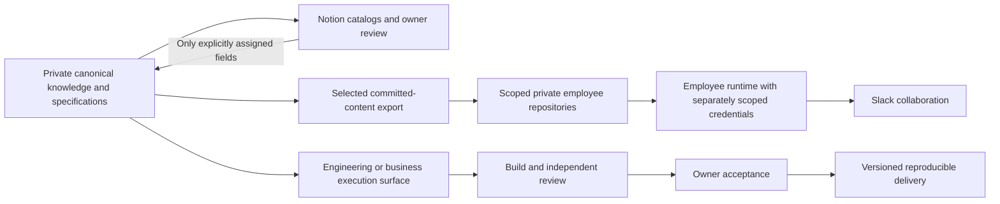

# Current architecture and evidence boundaries

**Version 1.0** · 2026-11-13

This dated addendum supersedes older introductory prose where it describes Notion
as universally display-only or treats role prompts as access controls. It describes
the intended ownership model and links the executable proof separately.

Knowledge/specifications remain canonical upstream. Execution surfaces own task
state. Notion review fields need explicit ownership; two-way authority is never
inherited by every database. This diagram does not assert all arrows have passed
live acceptance. Public repository evidence ships synthetic examples and selected
code, not any of those private knowledge or execution records.

| Report draft sections | Evidence home | What can be reproduced |
|---|---|---|
| Pages 5–13, vault/Notion construction and surface ownership | This architecture showcase | Design record and public evidence index; no private Notion database |
| Pages 13–17 and 34, architecture, repositories and employee permission boundaries | [Scoped workspaces](https://github.com/markyafi1991/scoped-ai-workspaces) | Local committed-content selection, fresh history and checked Git transaction |
| Pages 16–17 and 19–21, role identity, employee setup and Slack collaboration | [Governed Slack collaboration](https://github.com/markyafi1991/governed-slack-collaboration) | Offline event scope, one handoff and duplicate suppression |
| Pages 22–24 and 31–32, delivery and evidence identity | [Delivery evidence](https://github.com/markyafi1991/launch-engagement-automation/tree/f6de2227fa4ffbb50dbb07ea7d35180aa35e6cf1/evidence/2026-11-13) | Per-engagement state and stale-revision refusal; earlier intake extract stays limited |
| Pages 22 and 24, historical delivery pack | [Project Delivery Pack](https://github.com/markyafi1991/project-delivery-pack) | Existing composable skill specification and intake/Phase 0 code; current state slice is linked rather than duplicated |
| Pages 26–30, forecast example and analytical expectations | Proposed v1 pilot; no new runtime claim | No accepted forecast/report implementation added by this publication |

Rows intentionally overlap: pages 13 and 16–17 discuss both architecture and
the identity/access distinctions demonstrated by the narrower code slices.

Employee roles, runtime identity, repository credentials and application grants
are distinct. The public demos grant no access. Separate repositories reduce the
content available to a scoped credential; they do not audit all account-wide apps.
Recovery backups, employee working copies and public showcases serve different
purposes. No actual vault, client data, private operating record or restricted
personal material is included.

Working capabilities are the code paths and tests in each evidence slice. A
commissioned employee organization, a supported live round trip, a complete project
package, fresh-operator acceptance and v1 release remain separate acceptance work.
The [published July Beta report](https://www.linkedin.com/feed/update/urn:li:activity:7490949064436674560) is the predecessor. The November report
is an unpublished owner-review draft; its edition does not establish v1 shipment.

References: each showcase's `evidence-map.json`, `PROVENANCE.json`, tests and
publication review. Use the commit pins in `report-evidence-pins.json` for PDF claims.
