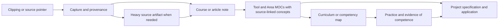

# Learning as a source-linked knowledge graph

**Version 2.0** · 2026-11-13

The learning subsystem is organized around resource notes, source artifacts,
Tool/Area MOCs, curricula and competency maps. This documents its current schema
and operating contract; the real library and enrollment records remain private.
[A1](evidence-and-status.md#a1).

## Capture and classification

`Clippings/` is a raw inbox, not authoritative strategy. A business bookmark is a
source pointer. A capture workflow turns an eligible resource into the appropriate
stored artifact and analysis. Heavy material belongs in `08_Learning/Sources/`;
course/resource notes and article notes have their own roles. Sources can retain
parent/volume relationships while a resource note holds the consumed or queued
learning record. Capture paths depend on the resource and workflow; this is not
one mandatory linear promotion chain for every input.

## Metadata is a contract

Shared note fields carry type, lifecycle dates and tags. Learning-specific fields
can describe resource type, author/publisher, original URL, area/tool, progress,
quality rating and a saved viewing position. `status` describes the note lifecycle;
`progress` describes learning progress. Resource presence, a saved bookmark, a
quality score, enrollment and demonstrated competence are different states.

The source URL and citation handle make later claims traceable. When a resource
has pages, timestamps or chapter parents, the claim should identify the relevant
location. A schema requiring provenance does not prove that every existing capture
is complete; audits identify missing evidence. Captured paywalled text is not
reproduced in this showcase.

## MOCs connect knowledge to work

A Tool/Area MOC links reusable concepts to the resource notes supporting them and
to applications. It lets a project find the relevant evidence without treating the
raw inbox as its source of truth. The [synthetic MOC](../examples/synthetic-vault/08_Learning/MOCs/Example%20Topic%20MOC.md)
and [project note](../examples/synthetic-vault/04_Portfolio/Example%20Project.md)
illustrate this relationship with completely invented content.

## Programs and execution surfaces

Curricula organize a path; skill trees track prerequisites and evidence; tutoring
and practice workflows can use them. Enrollment is a separate execution choice.
The current operating contract assigns committed membership to the designated
program board, with narrowly scoped reconciliation. Notion learning/catalog views
do not become a universal source for rewriting captured notes. Legacy schema
wording is interpreted through the current owning contract when they disagree.

This documentation review did not exercise a live enrollment round trip, tutoring
session, flashcard integration or all capture adapters. Those capabilities must be
judged on their own run evidence. No actual learning history is published.

References: [A1 and capability limits](evidence-and-status.md#a1),
[ownership table](architecture.md), [synthetic miniature](../examples/synthetic-vault/HOME.md).
